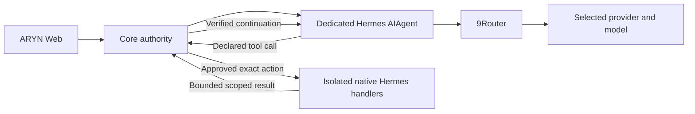

# Hermes and 9Router control plane

Implementation baseline: `024dd77a833c7fd865944a1206c98e3b5421e399`, `main`.
Owner-authorized consolidation, offline verification on 17 October 2026.
The owner authorized commit/push on 18 October; exact-commit CI is the delivery
gate. No public deployment, real provider key, paid inference or installed
runtime source mutation is part of this work. This document describes implementation and its
limits; local doubles never establish provider or hosting readiness.

## Authority and model routing

The inference path is Core → the dedicated native Hermes AIAgent → the guarded
9Router transport → the selected upstream. `ModelRouter` is policy/catalog only;
its default catalog is empty and its invocation method always rejects.

`NineRouterGateway` retains dynamic exact-ID discovery, refresh, expiry, model
identity checks and short-lived capability evidence. Catalog entries confer no
availability, tool capability or permission. No alternate model is selected on
failure. Known provider enums remain readable as historical data.

The Gemini, Nous and Mock descriptor adapters and their exports are removed.
Offline catalogs are explicitly composed in `tests/model_fixtures.py`. The
existing opt-in GitHub operator UAT explicitly constructs its isolated model
double catalog; it is not exposed in production model discovery and cannot
substitute for an unavailable gateway. No direct provider payload builder or
provider inference SDK was added to Core or the model adapter package.

Hermes' SDK client uses only `ExactGatewayTransport`, with one admitted dispatch
per Core turn, no SDK retries, no redirects or model substitution. Auxiliary
title, compression and background memory/review inference remain disabled because
they have no separately admitted budget/provenance contract. These restrictions
do not establish a limit on attempts inside 9Router.

Installed 9Router is **0.5.91**. Its executor retry/account rotation, credential
refresh, endpoint fallback and normalized model/usage metadata remain distinct
uncertainties. ARYN observes its own dispatches and reported usage; it does not
attest actual upstream request count, final billing, selected account or a
provider configuration revision that the gateway does not supply. See the
installed-source audit in `9router-gateway.md`. No live catalog or inference was
queried with the owner's key during this consolidation.

The installed package version is an installation audit, not an attestation of
software behind an arbitrary configured URL. Gateway binding proves agreement
between Core and its Hermes process on URL/key/instance identity. The trusted
operator must configure and verify the intended 9Router deployment; remote
gateway software/account identity has not been verified with user credentials.

**Upstream provenance blocker:** the existing live tool-probe contract requires
a provider configuration revision (`provider_configuration`) in both catalog
and completion evidence, alongside exact model/provider identity. A read-only
search of installed 9Router 0.5.91 source/compiled chunks found no producer of
that field (`.local/gateway-provider-revision-audit.json`). An ordinary response
without it cannot satisfy Core's live tool-calling gate. Native sandbox execution
with an offline model does not unlock that gate. A reviewed upstream provenance
extension or equivalent trusted, observable provider-binding contract is required;
the Core URL/key hash must not impersonate the upstream provider revision.
Normalized alias/model responses can also fail exact identity verification, as
documented in the source audit. Live compatibility remains unverified and gated.

## Credentials and configuration lifecycle

`GatewaySettings` and the existing Core process-memory credential protection,
audit signer and diagnostic redaction are reused. Environment variables remain
an explicit development bootstrap. Settings can replace/revoke a connection
through authenticated, CSRF-protected Core routes. The key is a write-only
`SecretStr`, excluded from response serialization and repr; no database,
browser cache, source file or log stores its plaintext.

Replacement checks the expected gateway identity, human `tool:register`
permission, current scope, current execution owner and the absence of active or
uncertain runs. New claims are fenced during replacement. The runtime repeats
the identity/in-flight checks, changes its instance binding, and returns only
nonsecret verification metadata. Catalog, readiness and probe evidence are
invalidated before I/O. An ambiguous/lost reply leaves the Core binding disabled;
an operator must reconcile/restart it rather than silently reuse old evidence.
Revocation clears the active credential and prevents discovery/inference through
that binding. Historical redaction material may remain in trusted process memory;
Python memory is not a secure-erasure facility. On restart the explicitly
configured environment bootstrap is evaluated again. A process-only revocation
does not revoke the upstream key or edit the operator's environment configuration.

This volatile lifecycle is intentionally unavailable for shared hosted gateway
administration. Before multi-user hosting, configure tenant-isolated runtime
bindings and an existing trusted persistent credential provider. ARYN does not
introduce a second secret manager or an unsafe plaintext persistence fallback.

Runtime configuration uses typed policies and fixed server-constructed read
models. Agent budgets, deadlines, model policy, grants, skill content pins and
execution environment have existing/typed controls. Native `admin_config_rw`
is false in the installed API. Unsupported configuration is not an arbitrary
YAML editor or a browser-controlled host path, worker image or environment map.

## Installed runtime audit

Hermes reports **0.21.6**, source revision
`3637c512fc3211bdccb61b7140d09ac1018508ba`. Its repository was clean when packaged
for verification. The installed configuration has `api_server: []`, local
terminal backend, enabled memory/user profile and compression, and 58 installed
skill files. Those global settings were read selectively without exporting
credentials and were not changed. ARYN now uses a separate runtime home;
global user skills, sessions, credentials, memory and jobs are not copied into it.

The installed bootstrap can otherwise complete source updates, recover a torn
checkout and publish/lease dependency generations automatically. ARYN's dedicated
process selects the existing dependency generation through the read-only selector,
refuses pending update/repair markers, disables lazy installs and replaces those
mutating startup hooks in that process. The isolated runtime home is pinned before
native bootstrap import. No global updater, dependency recovery, lease creation
or source/configuration write is authorized by starting ARYN. Operators must
quiesce/restart ARYN when updating the separately managed Hermes installation;
dependency lifetime across a concurrent upstream update is not certified here.

The observed runtime inventory discovers 63 toolsets without enabling them:

`a2a`, `bot_room`, `browser`, `browser-cdp`, `browser-use`, `catalog`, `clarify`,
`code_execution`, `coding`, `computer_use`, `connections`, `context_engine`,
`cronjob`, `debugging`, `delegation`, `desktop_ui`, `discord`, `discord_admin`,
`feishu_doc`, `feishu_drive`, `file`, `hermes-acp`, `hermes-api-server`,
`hermes-bluebubbles`, `hermes-cli`, `hermes-cron`, `hermes-dingtalk`,
`hermes-discord`, `hermes-email`, `hermes-feishu`, `hermes-gateway`,
`hermes-matrix`, `hermes-mattermost`, `hermes-qqbot`, `hermes-signal`,
`hermes-slack`, `hermes-sms`, `hermes-telegram`, `hermes-webhook`, `hermes-wecom`,
`hermes-wecom-callback`, `hermes-weixin`, `hermes-whatsapp`, `hermes-yuanbao`,
`image_gen`, `kanban`, `memory`, `project`, `safe`, `search`, `session_search`,
`setup`, `skills`, `start_chat`, `terminal`, `todo`, `tts`, `video`, `video_gen`,
`vision`, `web`, `x_search`, `yuanbao`.

Each has description/tools, availability, configuration readiness, risk,
permissions, environment, approval, enabled/executable state and verification
source. Unknown dependency/credential readiness remains unknown. Composite
toolsets do not grant their members automatically. API feature flags and method
presence are labelled source observations, not successful execution.

The installed API advertises `approval_events`, `model_options`,
`reasoning_streaming`, `run_approval_response`, `run_events_sse`, `run_status`,
`run_steer`, `run_stop`, `session_chat`, `session_chat_streaming`, `session_fork`,
`session_model_lock`, `session_resources`, `skills_api` and `tool_progress_events`.
Its `admin_config_rw`, `audio_api`, `jobs_admin`, `memory_write_api` and
`realtime_voice` flags are false. Job creation and cron-fire methods are present
despite the false `jobs_admin` flag, so inventory records those method observations
separately. Neither a flag nor a method proves a scoped execution lifecycle.

## Capability matrix

| Capability | Native surface found | ARYN behavior / evidence | Status and exact boundary |
|---|---|---|---|
| Text / multi-turn model execution | AIAgent and HTTP run/chat APIs | Native guarded transport and Core continuation protocol | Implemented; offline native verification; live provider not verified |
| Dynamic model catalog | 9Router `/v1/models` | Exact IDs, bounded metadata, refresh, expiry, safe failures, no fallback | Offline verified with HTTP doubles; real catalog/availability unknown |
| Skills discovery | Native skill catalog and CLI/API listing | Bounded metadata/content hash, source containment, no symlink escape | Implemented; isolated runtime home has no automatically imported global skills |
| Skills assignment | Canonical version metadata | Typed name/hash pins, fresh Core-signed content admission, immutable version review, pre-dispatch hash check | Offline verified; skill text confers no grant |
| Skills enable/disable | Native profile CLI; ARYN version configuration | Add/remove skill assignments on a draft and approve a new version | Implemented for agent configuration; global profile mutations blocked |
| Skills install/remove/update | Native CLI parsers/tool handlers | No global mutation/URL installer exposed | BLOCKED: no scoped official API lifecycle with source/integrity review and ownership; use reviewed upstream per-tenant bridge |
| Toolsets/tools | Native registry and toolset expansion | All discovered; exact Core-registered declarations only | Metadata implemented; no permanent name blacklist; unknown effects default deny |
| Terminal / filesystem | Native registry `terminal`, `read_file`, `write_file`, `patch`, `search_files` | Exact human-reviewed arguments, version grant pins, signed admission, real bounded container dispatch | Implemented; real Hermes/container offline verification; no host mounts/network/credentials |
| Code execution | Native `execute_code`; terminal can run approved code | Approved terminal commands can execute code inside the same isolated sandbox | Native `execute_code` RPC/nested tools BLOCKED until each nested action is mediated |
| Browser / web / external writes | Native browser/web/integration toolsets | Existing governed HTTPS/MCP/GitHub connectors retained | Native browser/network BLOCKED: no verified destination/write/credential policy in this worker; network is denied |
| Runtime sessions | Native session CRUD/fork/chat APIs | Existing Core conversations, project/run ownership, timeout/cancellation retained; native private turn IDs remain isolated | Shared native session administration BLOCKED; no raw native session headers accepted |
| Memory | Native memory tool/profile state; memory write API false | No parallel memory store; no global user memory loaded | BLOCKED for persistent native memory: scoped persistence/ownership and mutation mediation unverified |
| Streaming / progress | Native SSE/tool/reasoning/approval events | Existing Core SSE, scoped signed audit, tool admission/result evidence and sanitized diagnostics | Core progress implemented; raw token/event forwarding BLOCKED until scope/redaction/model provenance is established |
| Jobs / scheduler | Native job CRUD/pause/resume/run and cron dispatch methods | Existing Core automations preserved; no second scheduler created | Native background dispatch BLOCKED: scheduled firing lacks authenticated Core per-occurrence readmission and tenant worker ownership |
| Delegation / subagents | Native delegation toolset | Typed requests discoverable; unmediated child execution denied before model dispatch | BLOCKED: no proven inheritance of grants, budget, deadline, transport receipts and cancellation across children |
| Approval | Native run approval endpoints; Core human approval engine | Existing Core signed approval authority reused for exact native action bindings, version publication and connectors | Implemented; expiry/revocation/scope drift deny; interactive native run pause/resume not exposed |
| MCP / integrations | Native registry/plugin surfaces and existing Core adapters | Existing scoped MCP, HTTPS and GitHub approval/grant/receipt boundaries retained | Offline regressions retained; arbitrary native plugin ingress/credential integrations BLOCKED |
| Health / configuration | Native health/version and feature flags | Core Settings status, runtime binding identity, typed settings/policies | Implemented reads; unsupported native settings writes shown as unsupported |
| Audio API / realtime voice / memory-write/config admin API | Native flags explicitly false | No simulated endpoints | Unsupported by installed native API |

Native plugin `pre_tool_call` failures explicitly return `(None, original_args)`
in `agent/tool_executor.py`; that hook is not a fail-closed Core boundary. Native
session/job/profile ingress and independent background dispatch are therefore
not made reachable merely by filtering their HTTP routes. The bounded ARYN
application still owns its route table and does not call the unrestricted native
`connect` implementation. These are concrete security boundaries, not a claim
that native CLI feature names cannot be supported by a reviewed scoped bridge.

## Native execution and recovery

`CoreTools` reuses the existing permission/approval/audit authorities. Native
action registration verifies the installed worker schema and exact arguments,
requires current human administration and records an expiring signed approval.
The AgentVersion pins its binding hash and explicitly chooses `isolated_worker`.
The Core model loop emits only declared tools; every call revalidates version,
assignment, grants, owner authority, approval, quota and deadline before dispatch.
Unknown or changed arguments fail before side effects.

Core authorization continues to validate current signed history. Proven
read-only SQLite transactions hold the independent authority store's writer
lock through application commit, without creating unnecessary durable write
intents. SQL profiling, mutation counters and a freshly installed SQLite
authorizer distinguish actual reads from DML, DDL and mutating callbacks.
All mutations, unknown cases, protected-head updates and PostgreSQL keep the
original durable intent/recovery protocol. This is not a permission or history
cache; receipt formats and historical signatures are unchanged.

The Docker adapter accepts a trusted immutable image ID, never a browser image,
volume, environment or host path. Each run gets a distinct organization/project/run
derived container, UID/GID 65532, read-only root, no host mounts, no Docker socket,
no capabilities, no-new-privileges, no network or credentials, 1 CPU, 256 MiB RAM,
64 PIDs and a 64 MiB workspace. Output and concurrency are bounded. A TTL on the
primary process independently stops an orphaned container after the Core run
deadline; completion/cancellation also removes it. In-flight provider cancellation
and billing are not invented when only a Core fence is proven.

Filesystem state persists between admitted actions in one run. Each native
handler invocation uses a fresh process; PTY/process-management and exported shell
environment continuation are not exposed as verified session capabilities.
Worker dispatch never pulls a missing image implicitly.

Native tools execute their official registry handlers. The model never calls a
host-side synthetic terminal. The existing fixed read-only capability probe is
still a probe, and is not evidence of native sandbox behavior. Real native
verification executes terminal/file actions, checks denied networking and records
Core claim/admission/result/continuation evidence with an isolated model double.

Container isolation shares the host kernel; these local tests do not certify
resistance to unknown kernel vulnerabilities or multi-user hosting. Deploy a
reviewed dedicated/rootless worker host and operational image lifecycle before
hosting. Persistent sandbox recovery, interactive native approvals, child agents
and native scheduled work are deliberately not inferred from a successful fixture.

## Web and deployment configuration

Settings reuses the existing page and design system for 9Router lifecycle,
catalog, connection/binding state, installed runtime inventory, skills, toolsets,
unsupported states and exact native action review/revocation. Agent Factory
selects reviewed grants and skill content pins in its existing inspector. Runs
and existing Core audit/evidence views retain tool activity, usage, failures and
cancellation; raw runtime events and secrets are not forwarded to the browser.
All writes require backend RBAC/CSRF and existing signed Core authority.

Trusted operators can prepare an offline-reviewed image using
`scripts/prepare-native-worker.py` with a clean Hermes checkout, a reviewed base
image and an output directory. The script archives tracked source only, installs
hash-locked dependencies plus security constraints, and emits an immutable image
manifest. `python -m services.api --native-worker-manifest <manifest>` or the
existing launchers' `-NativeWorkerManifest` parameter binds it. Omitting the
manifest leaves native action execution unavailable. Never point the runtime home
at the user's global Hermes profile as a shortcut.

New metadata is optional inside the existing canonical AgentVersion metadata
envelope; no table, historical evidence rewrite or schema migration is required.
Historical provider enums and signed formats remain readable. New draft/native
actions require current canonical policy/grant validation. The four product
domains remain Factory, Relay, Brief and Bench; Core remains internal authority.

## Verification and delivery

See `runtime-consolidation-validation.md` for commands, actual outcomes, coverage
and CI performance evidence. Remote 14/14 and the commit-bound Validated Delivery
Artifact require exact-commit CI evidence. Owner review authorized commit/push
on 18 October 2026; remote delivery results must be verified on the pushed SHA.
The strategic documentation repository contains its index/scaffold, not the
approved corporate/PRD/architecture/security/roadmap documents; this implementation
does not promote an unavailable strategic draft to a new formal baseline.
